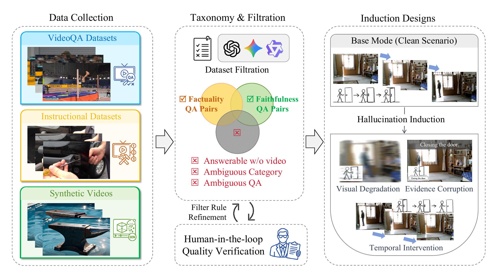
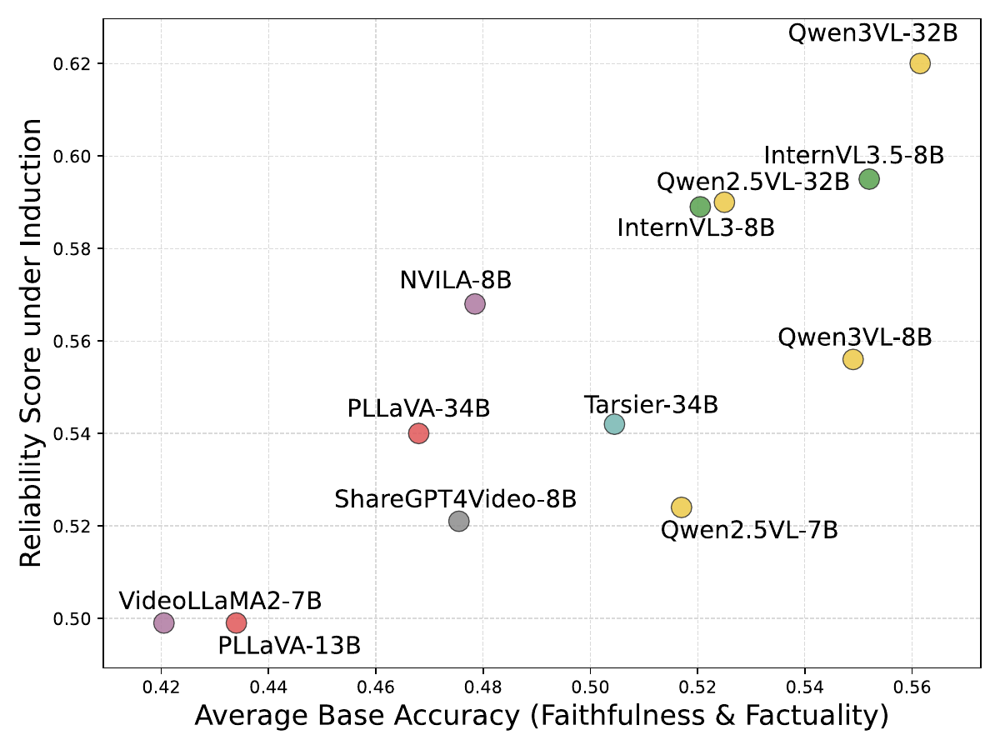
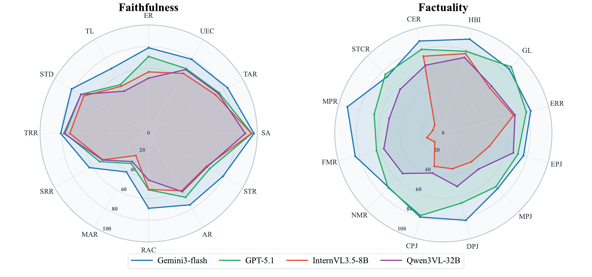

# INFACT

**A Diagnostic Benchmark for Induced Faithfulness and Factuality Hallucinations in Video-LLMs**

[](https://arxiv.org/abs/2603.11481) [](https://arxiv.org/abs/2603.11481) [](LICENSE)

Junqi Yang, Yuecong Min, Jie Zhang\*, Shiguang Shan, Xilin Chen. ICT, CAS.

<p align="center"></p>

## Abstract

Despite rapid progress, Video Large Language Models (Video-LLMs) remain unreliable due to hallucinations, which are outputs that contradict either video evidence (faithfulness) or verifiable world knowledge (factuality). Existing benchmarks provide limited coverage of factuality hallucinations and predominantly evaluate models only in clean settings. We introduce **INFACT**, a diagnostic benchmark comprising **9,800 QA instances** with fine-grained taxonomies for faithfulness and factuality, spanning real and synthetic videos. INFACT evaluates models in four modes: **Base** (clean), **Visual Degradation**, **Evidence Corruption**, and **Temporal Intervention** for order-sensitive items. Reliability under induced modes is quantified using **Resist Rate (RR)** and **Temporal Sensitivity Score (TSS)**. Experiments on **14 representative Video-LLMs** reveal that higher Base-mode accuracy does not reliably translate to higher reliability in the induced modes, with evidence corruption reducing stability and temporal intervention yielding the largest degradation. Notably, many open-source baselines exhibit near-zero TSS on factuality, indicating pronounced temporal inertia on order-sensitive items.

## What's here

- 9,800 multiple-choice items across two tracks: faithfulness and factuality.
- 12 + 12 fine-grained categories (see [`docs/TAXONOMY.md`](docs/TAXONOMY.md)).
- Four evaluation modes: **Base**, **Visual Degradation** (`gau` / `mb` / `cmp`), **Evidence Corruption** (`cap` / `sub` / `adv`), **Temporal Intervention** (`shu` / `rev`).
- Metrics: Resist Rate (RR) for label-preserving perturbations, Temporal Sensitivity Score (TSS) for order-destroying ones, each paired with the model's Base prediction.
- `adv` runs MI-FGSM separately against three proxies {InternVL3-8B, Qwen3-VL-8B, VideoMAE-large}; `RR_adv` is the mean of the 3 per-proxy RRs.

## Main results

### Faithfulness

| Model | Text-only | Base | RR_adv | RR_cap | RR_sub | RR_cor | RR_cmp | RR_gau | RR_mb | RR_deg | TSS_shu | TSS_rev | TSS̄ | Avg |
|---|---|---|---|---|---|---|---|---|---|---|---|---|---|---|
| PLLaVA-13B | 0.285 | 0.458 | 0.782 | 0.678 | 0.922 | 0.794 | 0.777 | 0.813 | 0.699 | 0.763 | 0.010 | 0.014 | 0.012 | 0.523 |
| VideoLLaMA2-7B | 0.261 | 0.434 | 0.751 | 0.564 | 0.910 | 0.742 | 0.818 | 0.725 | 0.749 | 0.764 | 0.113 | 0.091 | 0.102 | 0.536 |
| ShareGPT4Video-8B | 0.292 | 0.462 | 0.719 | 0.688 | 0.894 | 0.767 | 0.840 | 0.762 | 0.754 | 0.785 | 0.101 | 0.094 | 0.098 | 0.550 |
| PLLaVA-34B | 0.287 | 0.505 | 0.757 | 0.618 | 0.920 | 0.765 | 0.772 | **0.874** | 0.848 | 0.831 | 0.070 | 0.073 | 0.072 | 0.556 |
| Tarsier-34B | 0.302 | 0.568 | 0.785 | 0.644 | 0.960 | 0.796 | 0.759 | 0.846 | 0.612 | 0.739 | 0.158 | 0.208 | 0.183 | 0.573 |
| Qwen2.5-VL-7B | 0.278 | 0.531 | 0.630 | 0.659 | 0.973 | 0.754 | 0.804 | 0.727 | 0.640 | 0.724 | 0.230 | 0.258 | 0.244 | 0.574 |
| NVILA-8B | 0.293 | 0.533 | 0.804 | 0.669 | 0.963 | 0.812 | 0.797 | 0.853 | 0.809 | 0.820 | 0.122 | 0.150 | 0.136 | 0.589 |
| Qwen3-VL-8B | 0.295 | 0.557 | 0.676 | 0.715 | 0.941 | 0.777 | 0.829 | 0.785 | 0.744 | 0.786 | 0.224 | 0.189 | 0.207 | 0.590 |
| Qwen2.5-VL-32B | 0.286 | 0.538 | 0.817 | 0.724 | 0.949 | 0.830 | 0.790 | 0.824 | 0.773 | 0.796 | 0.198 | 0.204 | 0.201 | 0.609 |
| InternVL3-8B | 0.301 | 0.576 | 0.777 | 0.709 | **0.979** | 0.822 | 0.828 | 0.847 | 0.817 | 0.831 | 0.169 | 0.212 | 0.191 | 0.615 |
| InternVL3.5-8B | 0.294 | 0.606 | 0.796 | 0.721 | 0.978 | 0.832 | 0.841 | 0.792 | 0.850 | 0.828 | 0.171 | 0.241 | 0.206 | 0.622 |
| Qwen3-VL-32B | 0.287 | 0.602 | 0.809 | 0.718 | 0.975 | 0.834 | 0.802 | 0.836 | 0.815 | 0.818 | 0.248 | 0.289 | 0.269 | 0.640 |
| GPT-5.1 | **0.305** | 0.687 | 0.856 | 0.823 | 0.958 | 0.879 | **0.940** | 0.801 | 0.854 | 0.865 | 0.355 | 0.281 | 0.318 | 0.687 |
| Gemini 3 Flash | 0.295 | **0.784** | **0.886** | **0.914** | 0.962 | **0.921** | 0.942 | 0.859 | **0.892** | **0.898** | **0.581** | **0.492** | **0.537** | **0.785** |

### Factuality

| Model | Text-only | Base | RR_adv | RR_cap | RR_sub | RR_cor | RR_cmp | RR_gau | RR_mb | RR_deg | TSS_shu | TSS_rev | TSS̄ | Avg |
|---|---|---|---|---|---|---|---|---|---|---|---|---|---|---|
| VideoLLaMA2-7B | 0.272 | 0.407 | 0.676 | 0.590 | 0.917 | 0.728 | 0.818 | 0.723 | 0.772 | 0.771 | 0.000 | 0.000 | 0.000 | 0.500 |
| ShareGPT4Video-8B | 0.294 | 0.489 | 0.715 | 0.519 | 0.883 | 0.706 | 0.840 | 0.816 | 0.798 | 0.818 | 0.000 | 0.000 | 0.000 | 0.508 |
| PLLaVA-13B | 0.279 | 0.410 | 0.788 | 0.585 | 0.919 | 0.764 | 0.777 | **0.947** | 0.705 | 0.810 | 0.000 | 0.000 | 0.000 | 0.525 |
| NVILA-8B | 0.291 | 0.424 | 0.818 | 0.541 | 0.961 | 0.773 | 0.797 | 0.888 | 0.759 | 0.815 | 0.000 | 0.000 | 0.000 | 0.529 |
| PLLaVA-34B | 0.265 | 0.431 | 0.782 | 0.603 | 0.920 | 0.768 | 0.772 | 0.897 | 0.812 | 0.827 | 0.000 | 0.000 | 0.000 | 0.532 |
| InternVL3-8B | 0.295 | 0.465 | 0.738 | 0.612 | 0.951 | 0.767 | 0.828 | 0.914 | 0.813 | 0.852 | 0.000 | 0.000 | 0.000 | 0.540 |
| InternVL3.5-8B | 0.298 | 0.498 | 0.775 | 0.619 | 0.955 | 0.783 | 0.841 | 0.921 | 0.851 | **0.871** | 0.000 | 0.000 | 0.000 | 0.551 |
| Tarsier-34B | 0.289 | 0.441 | 0.909 | 0.625 | 0.960 | 0.831 | 0.759 | 0.930 | 0.820 | 0.836 | 0.000 | 0.000 | 0.000 | 0.556 |
| Qwen2.5-VL-32B | 0.296 | 0.512 | 0.804 | 0.624 | 0.930 | 0.786 | 0.790 | 0.889 | 0.764 | 0.814 | 0.105 | 0.101 | 0.103 | 0.568 |
| Qwen2.5-VL-7B | 0.281 | 0.503 | 0.670 | 0.575 | 0.968 | 0.738 | 0.804 | 0.784 | 0.774 | 0.787 | 0.212 | 0.262 | 0.237 | 0.587 |
| Qwen3-VL-8B | 0.296 | 0.541 | 0.707 | 0.606 | 0.929 | 0.747 | 0.829 | 0.793 | 0.768 | 0.797 | 0.339 | 0.334 | 0.337 | 0.627 |
| Qwen3-VL-32B | 0.305 | 0.521 | 0.809 | 0.641 | 0.963 | 0.804 | 0.802 | 0.904 | 0.821 | 0.842 | 0.231 | 0.254 | 0.243 | 0.630 |
| GPT-5.1 | **0.308** | 0.678 | 0.901 | 0.814 | 0.963 | 0.893 | **0.940** | 0.911 | 0.876 | 0.909 | 0.391 | 0.414 | 0.402 | 0.735 |
| Gemini 3 Flash | 0.305 | **0.752** | **0.917** | **0.839** | **0.969** | **0.908** | 0.942 | 0.902 | **0.881** | 0.908 | **0.741** | **0.696** | **0.719** | **0.845** |

Full tables (including standard deviations and additional breakdowns) live in the [paper](https://arxiv.org/abs/2603.11481).

### Base accuracy vs. induced reliability

<p align="center"></p>

Base-mode accuracy correlates strongly with induced-mode reliability (Pearson *r* = 0.978), but does not fully determine it — models with similar Base accuracy can diverge substantially under evidence corruption and temporal intervention.

### Per-category performance

<p align="center"></p>

Across representative models, factuality dimensions (esp. procedural judgement and physical reasoning) consistently lag faithfulness. On the faithfulness side, weaknesses concentrate on motion- and structure-centric skills (temporal localisation, motion attributes).

## Status

Annotations (`data/questions/*.jsonl`) and synthetic Know-WHY videos are **not yet released**; download link will appear here once the camera-ready artifact is finalised. Real-video splits point to upstream datasets — you must obtain those separately (see *Data* below).

The code has been sanity-checked but not all 14 model wrappers are end-to-end tested against the final release of each backbone repo. File an issue if a loader breaks on your setup.

## Install

```
pip install -r requirements.txt
```

`torch` / `transformers` are needed for local model inference; install a build matching your CUDA. API models (`gpt5_1`, `gemini3_flash`) need `openai` / `google-genai`.

Five backbones are not on PyPI and need to be installed from their own repos — each pins its own `transformers` version, so evaluate them in separate envs:

- VideoLLaMA2 — https://github.com/DAMO-NLP-SG/VideoLLaMA2 (`transformers~=4.40`)
- PLLaVA — https://github.com/magic-research/PLLaVA (imports via `models.pllava`, not `pllava`)
- NVILA — https://github.com/NVlabs/VILA (package name `llava`; isolate from any other `llava`)
- ShareGPT4Video — https://github.com/ShareGPT4Omni/ShareGPT4Video (`transformers==4.37.2`)
- Tarsier — https://github.com/bytedance/tarsier (branch `tarsier`, `transformers==4.44.2`)

Qwen3-VL needs `transformers>=4.57`.

## Data

Annotations follow:

```json
{"id": "...", "track": "faithfulness", "category": "3.4_temporal_localization",
 "level": 3, "source_dataset": "TOMATO", "video": "videos/tomato/xxx.mp4",
 "question": "...", "options": [...], "answer_idx": 2, "order_sensitive": true}
```

Upstream sources (obtain + agree to each one's license separately):

| Source | Used for | Link |
|---|---|---|
| MVBench | faithfulness | https://github.com/OpenGVLab/Ask-Anything/tree/main/video_chat2 |
| Video-MME | faithfulness | https://github.com/MME-Benchmarks/Video-MME |
| TOMATO | faithfulness | https://github.com/yale-nlp/TOMATO |
| CityGuessr68k | factuality / domain | https://github.com/ParthPK/CityGuessr |
| ViMUL-Bench | factuality / domain | https://github.com/mbzuai-oryx/ViMUL |
| COIN | factuality / procedural | https://github.com/coin-dataset/annotations |
| MedVidQA | factuality / procedural (clinical) | https://github.com/deepaknlp/MedVidQACL |

`cap` reads an irrelevant-caption pool from `data/meta/irrelevant_captions.txt` (one line per caption; a small sample is at `data/meta/irrelevant_captions.sample.txt`). Per-item `meta.misleading_caption` and `meta.transcript` must be produced during benchmark construction (not scripted in this repo).

## Run

```
# 1. perturb
python scripts/perturb.py --split faithfulness --ops gau mb cmp cap sub shu rev
python scripts/perturb.py --split faithfulness --ops adv        # GPU

# 2. infer (per model)
python scripts/eval.py --model qwen3_vl_8b --split faithfulness \
    --out runs/qwen3_vl_8b/faithfulness

# 3. aggregate
python scripts/score.py --runs runs/qwen3_vl_8b/faithfulness --split faithfulness
```

`python scripts/eval.py --list-models` prints the 14 registered names.

## Licensing

- **Code** in this repo: MIT (see `LICENSE`).
- **Annotations** (once released): CC-BY-4.0; cite this paper and all applicable upstream sources.
- **Real videos**: not redistributed by us; retain the license of their original source dataset.
- **Synthetic Know-WHY clips** (once released): subject to the generator's terms (OpenAI Sora, Alibaba Wan2.5, Google Veo 3). We release prompts + seeds so users can regenerate under their own accounts when redistribution is restricted.
- **Proprietary-model outputs** (GPT-5.1, Gemini 3 Flash): the numerical results reported in the paper were produced for academic benchmarking and are not intended for training competing models.

## Ethics & intended use

- **MedVidQA** contains medical / clinical instructional content. INFACT's Know-HOW clinical subset is intended for benchmarking language-grounded procedural reasoning **only**. These videos and QA pairs are **not** clinical guidance and must not be used to train, tune, or deploy any medical decision-support system.
- **CityGuessr68k** ties images to geographic locations. Use within the bounds of its original license; do not attempt to de-anonymise uploaders.
- **Synthetic Know-WHY** probes intentionally violate physical laws to test factuality. Do not mine them as training data for generative models.

## Citation

If you use INFACT, please cite both this paper and all upstream sources you use videos / QA from.

```
@inproceedings{yang2026infact,
  title     = {INFACT: A Diagnostic Benchmark for Induced Faithfulness and Factuality Hallucinations in Video-LLMs},
  author    = {Yang, Junqi and Min, Yuecong and Zhang, Jie and Shan, Shiguang and Chen, Xilin},
  booktitle = {Proceedings of ACL},
  year      = {2026},
  url       = {https://arxiv.org/abs/2603.11481}
}

@misc{yang2026infact_arxiv,
  title         = {INFACT: A Diagnostic Benchmark for Induced Faithfulness and Factuality Hallucinations in Video-LLMs},
  author        = {Yang, Junqi and Min, Yuecong and Zhang, Jie and Shan, Shiguang and Chen, Xilin},
  year          = {2026},
  eprint        = {2603.11481},
  archivePrefix = {arXiv},
  primaryClass  = {cs.CL}
}
```

Contact: `yangjunqi23@mails.ucas.ac.cn`.
